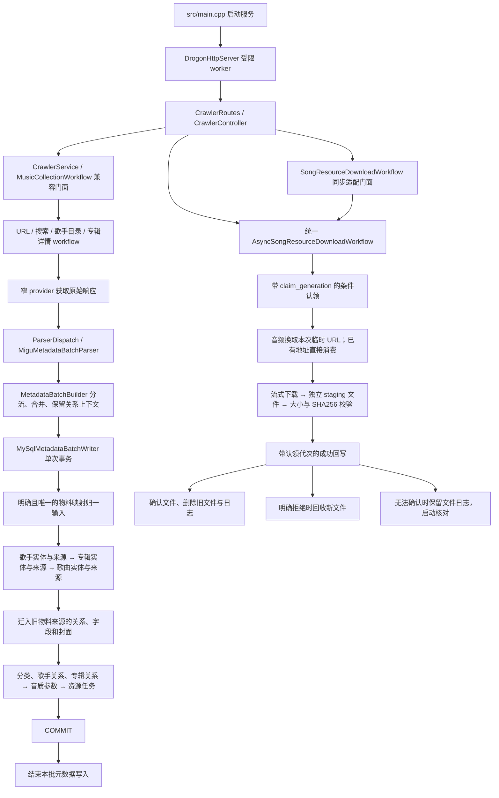

# 元数据与歌曲资源持久化流程

本说明对应 `codex/resource-persistence-flow`，以 `f48011b` 为分析基线。SQL 的已应用迁移保持不变；本轮新增 `V2026102602__resource_claim_generation.sql` 和物料查询索引迁移 `V2026102701__migu_album_material_lookup.sql`。

## 本轮实际改变的调用链

`src/main.cpp` 是服务启动入口，没有一套绕过 application 的独立生产 CLI 入库实现。现有集成测试程序是验证入口。SQLite debug 保留原有领域仓储兼容行为；下文原子来源写入链路以正式 MySQL 装配为准。

## 入口与写入矩阵

| 入口 | 实际编排与解析 | 事务内写入 | 事务外资源、状态 |
|---|---|---|---|
| 歌手索引 `/api/migu/singers/crawl` | `SingerCatalogWorkflow` → `SingerCatalogProvider::fetchSingerIndexPage` → `SingerSourceParser` | `singers`、`singer_source_refs`、全部 `singer_index_memberships`、`singer_resources` 结果 | 只登记头像 URL；跨 tab 合并实体并保留全部归属 |
| 歌手资料（随目录采集） | `CatalogMetadataCompletion::singerContext` → `SingerProfileParser` | 本响应名称对应实体与来源、声明总数、头像 URL | 总数未知时取完整资料，`force` 显式刷新；随目录批次保存，不逐字段请求 |
| 歌手歌曲 `/api/migu/singer-songs/crawl-from-db` | 分页获取、检查分页、`SongSourceParser`，标记入口歌手 `is_seed` | 歌手、专辑、歌曲及来源；`song_artist_refs`、`album_song_refs`；实际音质和资源任务；有真实专辑歌手上下文时才写 `album_artist_refs` | 复用歌手资料和专辑完整响应，只携带本批已选歌曲；不逐字段请求 |
| 歌手专辑 `/api/migu/singer-albums/crawl-from-db` | `AlbumSourceParser`，把入口歌手身份写入关系输入 | 专辑及来源、入口歌手关系、封面 URL；不修补歌曲表 | 列表内专辑按来源补齐详情，详情附带曲目不扩展当前采集范围 |
| 专辑详情 `/api/migu/backfill/album-details/retry` | `crawlAlbumDetailAndSave` → 两个入口共用 `collectAlbumResponse` | 完整 batch 的专辑、独立歌手、歌曲、关系、音质、资源任务及详情/曲目结果 | 用本响应的唯一曲目数与声明总数判断曲目结果；完整时不再进入曲目待处理队列；推荐卡片仍保持摘要状态 |
| 专辑歌曲 `/api/migu/backfill/album-songs/retry` | `crawlAlbumSongsAndSave` → 同一详情获取与完整 batch 保存 | 同上；空曲目仍保存有效专辑信息 | 数量不符或声明总数未知时为 `4 部分完成`；没有已知声明总数的部分完成记录不由默认入口自动重选，显式重试/重置仍可执行 |
| 关键词搜索 | `SearchCollectionWorkflow::searchSourcesAndSave`；歌曲数组、专辑 `data.result` / `albumResultData.result` | 先按请求 limit 裁剪，再统一来源事务；不再生成第二套领域结果写公共表 | 只展开已选中的专辑；错误不会因为已有内存列表而被报告成功 |
| URL 采集 | `UrlIngestionWorkflow` → `RawPageFetcher` → `parseSources` | 一个响应的实体与关系统一提交 | 不再先来源写入、再 `saveParseResults` 重写公共表 |
| 同步资源 `/api/migu/resources/process` | 同步门面把旧 ports 转换为异步 ports，委托统一资源编排 | 条件认领、成功/失败/永久跳过回写均为短 SQL | 保留流式回调和受限 executor，不把整首音频聚合到内存 |
| 异步资源 `async=true` | 原生 async provider / fetcher → 相同编排 | 同上；批次通过 recorder 写 item/event | 多音质的关联资源按歌曲来源和 kind 去重；下载时不持有数据库事务 |

生产装配在 `PersistenceAssembly.cpp` 创建事务 writer 与来源/队列 adapter。`MetadataIngestionDependencies` 只包含元数据 writer 和诊断 port，不再注入封面保存器或歌曲资源下载器；`/resources/process` 继续使用原有资源编排。新增流程没有依赖 `IMusicProvider` 或 `MetadataParser` 聚合接口。

## 发现的重复及处理

| 基线位置 | 问题 | 最终处理 |
|---|---|---|
| `SearchCollectionWorkflow::collectSongPage/collectAlbumPage` | 来源保存后再次解析同响应为领域对象；页内写入早于最终 limit | 正式路径改为来源批次解析；有序归并先裁剪再写入。旧领域方法仅服务无原子 writer 的兼容装配 |
| `UrlIngestionWorkflow`、专辑详情解析 | 分别解码同一 JSON 得到多套实体结果 | `MiguMetadataBatchParser` 只解码一次 JSON，调用现有按实体拆分的字段提取 helper |
| `MetadataBatchBuilder` | 重复专辑直接覆盖，稀疏项丢失同批次完整资料；重复歌曲卡片重复 upsert | 按稳定身份合并非空字段；详情优先，关系/音质补集；不同专辑上下文仍保留，避免误删关系 |
| `saveSingerSourceProfile` | 仅更新数量，忽略同响应已知实体与头像 | 概览模型携带真实实体片段；实体、来源、声明总数在同一元数据事务保存 |
| 元数据关联资源地址 | 元数据入库附带图片和歌词下载，混入文件与网络耗时 | 歌手、专辑 URL 保存到各自资源表；元数据不下载二进制。歌曲资源仍通过独立资源入口和 listen 获取 |
| 同步/异步资源 workflow | 分别维护几乎相同的重试、去重、文件提交、状态回写策略 | 同步入口只委托；唯一编排按认领/传输/关联资源/回写职责拆分实现文件 |
| `song_resources/upsert.sql` | 元数据重采把 `status=1` 改回 0，失败状态也被无条件重置 | 元数据 upsert 只补任务，不改变已有生命周期 |
| `mark_succeeded/mark_failed/mark_skipped` | 未验证认领身份，旧 worker 能覆盖恢复后的新任务 | 新增递增代次；条件更新拒绝过期 worker，永久跳过仍保护 status=2/4 |
| `AsyncRelatedResources` | 去重分支持 mutex 调用 listener，甚至挂起；异常可能把已完成音频误报失败 | 锁只保护集合；通知与 I/O 在锁外；关联异常独立结束其目标，不改写音频成功结果 |
| 文件与 DB 回写 | 文件提交后拒绝回写会留下孤立文件；固定路径可能覆盖旧成功对象 | 本次尝试独立对象、数据库确认前可补偿、旧对象确认后删除；模糊提交保留日志核对 |
| 专辑 pending 与单项入口 | 同时维护两套详情/歌曲采集与状态分支 | pending 入口通过受限 page runner 委托同一单项操作；详情与歌曲状态分开 |

具有明确用途的重复包括：跨采集入口的实体/关系 upsert 承接新增真实资料并保证幂等；同一歌曲属于多个专辑时分别写关系；不同音质各自换取临时音频 URL；专辑搜索摘要与所选专辑详情分别补充信息。歌手、专辑、歌曲封面各有资源所有者，资源归属必须分开；这不代表相同封面字节必须重复请求。旧 SQLite debug 和聚合构造函数没有被伪装成已完成原子迁移。

## 当前尚未消除的请求与写入重复

- 歌手头像、专辑封面：`saveMetadataBatch` 在本响应带 URL 且没有预填 `cover_resource` 时，都会调用 `MetadataCoverStore::save`；后者直接执行 HTTP GET，没有先查询已成功的本地资源。因此同一实体跨批次重采仍会重新下载封面、更新资源路径并在提交后清理旧文件。记录数量不增加不等于没有重复网络请求。
- 相同图片用于专辑和歌曲封面时：两个资源所有者各自保存，目前也分别请求。真实验收中的一张专辑封面和歌曲封面都是 104020 字节、SHA256 相同；HTTP 内容复用尚未实现。
- 相同歌曲的不同专辑上下文：批次构造保留这些输入以正确写入各专辑关系；当前 writer 也会相应重复 upsert 歌曲实体、来源及音质。关系写入必要，实体/音质写入仍有进一步按来源身份合并的空间。跨分页、跨入口的幂等 upsert 也仍会访问数据库，不能用行数不变证明 SQL 次数为零。
- 歌手分页：分页摘要检查和来源提取仍分别解码 JSON；并发分页窗口可能在达到 limit 前已经预取额外页。这属于可减少的解析/请求工作，不应描述为所有入口都已单次解析、恰好请求所需页数。

以上是当前进度边界，尚未作为已完成的性能优化报告，也没有测量整个流程 HTTP 请求数下降的百分比。

## 设计复核与封面数据来源

元数据实体、来源、关系、音质及任务在同一短事务内写入，这个一致性边界合理；不应按歌手、歌曲、专辑各自独立提交后再修关系。事务大小仍需收敛：歌手歌曲按页写入，但歌手专辑入口当前先收集多页再一次保存，全量模式可能形成较大事务，应改为按页或受限批次提交。

当前歌手头像和专辑封面虽然在 SQL 事务外下载，却发生在元数据提交之前，会延迟元数据写入，并增加文件补偿的复杂度。更简洁的目标是：响应一次解析并分流，先提交元数据和资源任务；随后按资源所有者处理已有临时地址，复用已完成且本地文件有效的结果，只有缺失、失败或明确刷新才下载；资源结果通过独立短事务回写。该目标尚未全部实现。

拼音不是独立采集流程：歌曲 `songPinyin/songNamePinyin`、歌手 `singerList[].nameSpelling`、专辑 `albumPinyin/albumNamePinyin` 均来自当前响应，并随对应来源记录写入。当前正式 MySQL 装配不会调用旧兼容路径中的 `updateNamePinyinBatch`；旧方法也只使用已有解析数据，不发补拼音 HTTP 请求。缺失拼音应保留历史或留空，不应为一个字段额外请求详情。

歌手、专辑封面下载并非全部由本轮首次实现：基线中的 `cae50c7` 已引入 `MetadataCoverStore`、`MetadataPersistenceBatch` 的封面准备，以及 `singer_resources/album_resources` 写入。当前数据来源如下。

| 对象 | 响应字段与本轮范围 |
|---|---|
| 歌手 | 原有索引卡片 `ZJ-Singer-Item.img`；本轮新增歌曲 `singerList[].img` 的头像分流，以及资料卡片 `ZJ-SingerDetail-Item.img` 的实体保存 |
| 专辑 | 专辑列表卡片 `img`、详情 `imgItem/imgItems`；本轮补充搜索 `data.result[].imgItems` 的解析 |
| 歌曲封面被用于专辑 | 基线已有 `album.cover_url = song.cover_url` 兜底；真实验收中的一张专辑资源由该路径产生。下载成功只能证明文件与回写链路，尚不能独立证明普通歌曲图片字段必然属于专辑封面，应收紧为明确的专辑图片上下文，不应为缺图额外请求详情 |

真实验收中的歌手、专辑资源记录由独立测试运行生成，不代表正式数据库已补齐，也不能把“表中有成功资源行”当作所有业务归属和刷新策略都已验证。当前仍需完成上述请求去重、资源后置和批次大小收敛，不能仅以测试通过报告整体优化已结束。

## 元数据 API 触发方式评估

当前 8 个采集触发 API 覆盖按歌手发现和采集的主干，异步返回 batch_id 并复用任务进度/取消入口的方式应保留。按 ID 触发与从数据库选择目标被拆成两个 API，是调用方式差异；专辑详情已能在一次响应中分别保存详情和曲目结果，完整时不会再由曲目入口重复获取。当前适合定向操作，日常完整采集仍需要调用方安排依赖。

建议先将基础入口从 8 个收敛为 5 类，而非把所有职责塞入一个 controller：

| 当前入口组 | 收敛方向 |
|---|---|
| 歌手索引 | 保留独立发现入口，继续按 tab 选择目标 |
| 歌手资料刷新 | 保留独立能力，支持明确歌手 ID 或数据库过滤选择，不局限于已有记录 |
| 歌手歌曲、歌手歌曲 from-db | 合并为一个用例入口，目标来源通过互斥的 ID 列表/过滤条件表达 |
| 歌手专辑、歌手专辑 from-db | 同上，采集、状态、重试和去重策略共用 |
| 专辑详情、专辑歌曲 | 已共用获取流程并复用完整曲目成果，保持两个路由；后续是否合并路由按交互需要决定 |

旧路由可作为兼容委托保留。目标数量和每个目标采集数量应使用明确且一致的参数，避免 limit 在各入口中语义不同。仅合并 URL 不会减少网络请求，还必须统一目标去重与取数复用。需要一键采集时，总任务只编排已有用例和依赖，按实际缺失的阶段执行，不为拼音等单个可选字段追加请求。

API 覆盖与数据完整性还存在以下缺口：

- 专辑两个采集入口当前只传 source、limit，再从已存在的待处理队列选择目标，不能直接指定新专辑 ID 启动首次采集；合并入口应支持明确 ID 与数据库选择。
- 歌手资料刷新先查询已有歌手；两个声明总数存在时默认跳过。这是总数刷新策略，不能当作全部歌手资料完整性的判断。
- 没有按歌曲 ID 定向补齐元数据的独立 API；关键词搜索采集虽有内部 workflow，也没有公开触发路由。是否补充应以实际使用场景和受支持的上游能力为准。
- 当前声明总数未知时，执行成功不能证明采集完整；还缺少按支持字段、缺失端点和去重关系数量进行的统一完整性核对。平台未返回的可选字段应显示未知并保留历史，不应为了填空无限请求。

因此只能报告主干采集能力已覆盖，不能报告全部元数据都能自动完善。当前仍保留 8 个触发入口；本轮改变了响应复用与成功判定，没有删除或合并路由。

## 字段来源与所有者

| 数据 | 来源及所有者 | 边界 |
|---|---|---|
| 歌曲 title / normalized_title | 当前响应歌曲标题 → `songs` | 不回填歌手、专辑、平台时长 |
| 歌曲双 ID、来源类型、时长、歌曲拼音、copyright_id | 歌曲响应 → `song_source_refs` | 双唯一约束与至少一个有效 ID 的 CHECK 保留；版权 ID 仍服务 listen |
| 歌手名称 | 当前歌手实体片段 → `singers` 名称池 | normalized_name 去重仅复用名称条目；歌曲中的合唱展示文本不冒充单个歌手名称 |
| 歌手来源 ID、类型、拼音、地区、声明总数 | 索引/资料/歌曲 singerList → `singer_source_refs` | source + source_singer_id 才是来源实体身份；男、女、组合类型独立保存在 source_gender；未知类型不覆盖已有值 |
| 专辑标题、发行日期、稳定身份 hash | 专辑卡片/详情/歌曲专辑片段 → `albums` | identity 仍由 source + source_album_id 形成 |
| 专辑来源 ID、resource type、kind、summary、声明总数、source_title_pinyin | 专辑卡片、搜索、详情，以及歌曲中的真实专辑拼音 → `album_source_refs` | 非空详情优先（包括任务重置后）；重置保留最近成功时间，不用任务状态冒充资料新旧；没有拼音的响应不清空历史值；不恢复 `source_title` 或歌曲表中的专辑拼音列 |
| 数字专辑目录 ID 与物料 ID | 歌曲 `dalbumId` → 专辑来源身份；歌曲 `albumId` → `migu_dalbum_details.source_material_id` | 外层专辑详情上下文优先；没有 `dalbumId` 时保留普通 `albumId` 路径，不按标题猜测身份或追加详情请求 |
| artist role/order/primary/seed | 解析顺序与入口上下文 → `song_artist_refs` / `album_artist_refs` | 只保存两端来源主键和关系属性 |
| disc/track/song_order | 专辑曲目响应 → `album_song_refs` | 歌手歌曲列表位置不冒充专辑曲序 |
| format_type、resource_type、iformat/aformat、isize/asize | 当前 `audioFormats/newRateFormats/rateFormats` → `song_source_audio_formats` | 不删除仍用于资源请求或大小判断的格式参数 |
| 歌手头像、专辑封面 URL | 采集响应 → `singer_resources.remote_url`、`album_resources.remote_url` | 只登记非空地址，不在采集阶段下载；稀疏输入和摘要不能覆盖更完整地址 |
| 歌曲临时音频、cover/lrc/mrc/trc URL | listen 响应 → 当前下载调用 | 不写入歌曲来源表或歌曲资源表；既有资源处理逻辑保持不变 |
| local_path、size_bytes、checksum、处理错误 | 文件完整提交后的实际结果 → 对应资源表 | 下载和校验前不得 status=2；空字段重采不清空成功结果 |
| claim_generation / running_batch_id | 认领 adapter → `song_resources` | 内部并发控制信息，不是平台元数据 |
| detail_sync_status / songs_sync_status / songs_sync_count | application 根据当前专辑响应分别计算 → `album_source_refs` | 同一次响应可提交两个独立结果；`songs_sync_count` 只取本响应唯一曲目数，`album_songs_count` 始终为关系事实数量 |
| 批次、item、event | recorder → `crawl_batches/items/events` | 只记录结果、阶段和脱敏身份；取消标志不会被后续 Running 进度覆盖 |

解析模型中保留专辑、歌手上下文是为了首次分流和写关系。它不意味着这些属性会持久化到 `songs` 或 `song_source_refs`。既有专辑 transport 模型的价格/活动/VIP 兼容字段本轮没有扩大持久化用途。

同名来源可以共用名称池行，但查询、类型筛选、同步认领和歌曲/专辑关系均使用独立的来源身份。`singers.gender` 仅保留列兼容并固定为 0，API 的 `gender` 取 `singer_source_refs.source_gender`。迁移 `V2026102702` 优先用各来源自己的索引分组恢复历史类型；没有可用分组时，仅独占名称行的来源可继承旧类型，共用或分组冲突的来源保留未知，不猜测实体归属。

## 事务、文件和失败边界

1. provider 获取元数据响应、parser 分流在数据库事务外进行；元数据阶段不下载图片或歌词。
2. `MySqlMetadataBatchWriter` 使用一个连接和一个事务，依次写歌手、专辑、歌曲实体与来源，再写归属、关系、音质、歌曲资源任务和歌手/专辑图片地址；每个 SQL 写入模板只修改所属表。死锁重试有界，不包含文件下载。
3. 明确回滚时实体、关系与图片地址一起回滚；COMMIT 响应不确定时返回既有 `ServiceResult` 的 `CommitUncertain`，不盲目重试整个事务。
4. 元数据提交后直接结束本批写入，不触发歌曲封面、歌词下载；歌曲资源由现有 `/resources/process` 独立认领和下载。
5. 音频资源先条件认领，再请求本次 listen URL；只对网络、超时、5xx 等可恢复失败有界重试，每次音频重试重新换 URL。
6. 流式内容写入独立临时文件，检查完整大小及 SHA256 后提交到本次尝试独占的最终路径。新路径保留 `migu/songs/{contentId}/{kind}` 目录及音质/歌词种类和扩展名，文件名增加尝试后缀。调用方使用 DB 返回的实际 local_path，不能自行拼固定文件名。
7. DB 明确拒绝成功更新时清理新对象；明确成功后才解除补偿、删除旧对象。连接异常时先读取该行事实；仍不可确认则产生 `writeback_uncertain`，保留新文件与 `.resource-writes` 日志。
8. 启动时根据来源资源实际路径与任务代次核对日志：已被 DB 引用的文件保留；仍被同代次认领的文件保留；已失效的对象及其临时文件清理；数据库不可查询时保留。歌手/专辑封面通过自己的资源表核对，不能借用 song_resources 归属。
9. 进程中断后的 running 状态继续通过已有 recover-stale API 恢复；随后新认领代次使旧 worker 无法回写。若启动时任务仍为 running，日志保守保留，完成 stale 恢复后下次启动会继续核对。存储根目录应由单个服务实例管理，避免不同实例同时回收尚在下载的资源文件。
10. 取消在新目标和下载块边界协作检查；当前网络请求仍受超时约束。已认领但取消的目标写可恢复失败，不伪造成功或永久跳过；已经提交的对象保留。

永久限制 `440000/440015/440016`（以及既有永久码）作用于整首歌所有未完成资源，status=2 始终保留。`440013` 仍按已有刷新一次策略处理，不能升级为永久跳过。关联 URL 缺失记录 `relatedResourceUrlMissing` 诊断，不制造来源不存在的任务；有 URL 但任务无法认领仍返回 `related_not_claimed` synthetic skipped item。成功关联资源由唯一任务约束保护，后续音质不会重复下载。

## 验证与交付边界

2026-10-26 本地验证结果如下。构建目录与运行目录均独立于原工作区；所有数据库写入都限制在显式命名的 `crawler_ownership_test_flow_*` 测试库。

| 验证 | 结果与实际覆盖 |
|---|---|
| Windows MSVC Debug 全量构建 | 全部 target 编译和链接成功，包括 demo 与集成测试程序 |
| CTest | 29 项通过，包含新增 `MySqlAlbumIdentityTest`；排除依赖外部登录或真实采集的入口测试，MySQL ownership 单独执行 |
| MySQL 已有 schema 升级 | `crawler_ownership_test_flow_upgrade_20261027_012554` 通过迁移、重启、重复运行、事务回滚、幂等写入和资源状态断言 |
| MySQL 全新 schema | `crawler_ownership_test_flow_fresh_20261027_012554` 成功初始化；两种 schema 均成功 prepare 全部 155 个运行 SQL 模板 |
| 来源与任务回归 | 搜索先裁剪、URL 单次来源保存、资料和总数同事务、稀疏资料不降级；新增独立歌手传递、完整/部分/未知曲目、重复卡片、错误专辑响应、推荐摘要不误标完成和零目标队列 |
| 资源故障回归 | 文件写入异常、大小不符、HTTP 200 错误文档、取消、过期认领成功/失败/跳过回写、数据库拒绝、未知提交、离线/活跃/失效日志恢复、旧文件替换均有断言 |
| 元数据到资源的 MySQL 集成 | 实际 DB 与实际文件 adapter 配合离线 HTTP fixture，覆盖元数据只登记图片地址和待处理任务、随后显式触发 SQ/HQ 音频写入、关联资源不重复下载、成功任务不重复认领；fixture 音频不称为真实上游音频 |
| MySQL 连接获取超时 | 本地无握手监听端口，12 个并发获取都在有界时间内结束，不依赖真实数据库故障 |
| clangd | 本轮新增物料身份归一、别名迁移、详情 workflow 检查无错误；此前批次构造、流式传输、Migu 批次 parser、连接池、资源回写和文件会话也已检查 |
| 编码与依赖方向 | 本轮变更文件 UTF-8 无 BOM；`git diff --check` 通过；新增 application 代码无基础设施/JSON/数据库头依赖、无具体控制台日志；历史 migration 未改动 |
| 真实 HTTP 与文件 | 独立服务端口 5947、TLS 校验开启，完成歌手 112 歌曲采集两次、歌手索引和专辑列表采集；第二次采集表数量不变。最终 6 个成功文件逐一核对大小与 SHA256：歌手头像、两张专辑封面、歌曲封面、普通歌词、原始 MRC。测试服务结束后已停止 |

真实验收使用 `crawler_ownership_test_flow_live_20261026_161917`，结构化结果位于 `D:/codex-runs/crawler-resource-flow/20261026_161917/acceptance.json`。构建、CTest、MySQL 和 clangd 日志位于当前独立 worktree 的忽略目录 `build/resource-flow-verification/`，构建日志另存于 `build/resource-flow-build*.log`；这些运行资料不进入提交。

随后按用户列出的表进行只读复核，结果保存于 `build/resource-flow-verification/persistence-audit.json`：歌手及来源各 1 条，索引归属 1 条，歌曲及来源各 1 条，专辑及来源各 2 条；三类实体关系各 1 条且悬空关系均为 0。资源表中歌手封面 1 个、专辑封面 2 个、歌曲封面/LRC/原始 MRC 各 1 个为 status=2，重新读取实际文件后大小及 SHA256 全部一致。该库中的 5 种音质任务为 status=0，不能称为真实音频已经下载完成。

真实音频尚未完成成功下载验收，需要本地有效登录态。真实响应未提供 TRC，因此 TRC 只由 fixture 覆盖；rclone/云上传兼容接口保留，本轮未做真实云端验收。正式数据库、原 8080 服务、本地凭据与历史备份未用于测试写入。现有 GitHub CI 未配置，本地通过不表示云端 CI 通过。

这些验证针对独立 worktree 当前改动与独立测试库。本轮尚未提交合入 main，也未将正式 8080 服务切换到本构建。

## 2026-10-27 全量分页复测

前轮独立库 `crawler_ownership_test_fieldaudit_20261026_233842` 保留原始失败证据：歌手 112 声明 413 首歌曲、41 张专辑，歌曲完整而专辑只采集 40 张；共 9 项差异归于两项原因。本轮只修复这两个已证实的问题，没有调整 API：

- `MiguPageInspection` 按专辑接口实际每页 10 条判断尾页，歌曲接口仍为每页 50 条。满页、最后一页和空页分别有离线断言。
- 歌曲解析使用 `dalbumId` 关联数字专辑目录，保留 `albumId` 的物料映射；外层专辑详情上下文仍优先。直接复用当前响应，避免追加请求，沿用既有事务 writer，不新增编排层。

先回放前轮保存的真实响应，413 首歌曲、41 张专辑及 Mojito 的目录身份、物料和拼音全部通过；再重新构建全部 target、运行 28 项 CTest 和 MySQL ownership 验证，均通过。两个修改的 parser 实现也通过 clangd 语法检查；歌曲实现检查禁用了 clangd 的 ExtractFunction 等编辑动作，避免将其提取代码失败误报成编译错误。

本轮真实采集使用新库 `crawler_ownership_test_fieldaudit_20261027_001710`。经生产 controller 在进程内调用实际 application、Migu provider/parser、MySQL 和文件 adapter；保留全部原始响应，并通过 mysqlsh 的只读一致性快照独立核对字段，未重新启动 Drogon 入站 HTTP 服务。

| 核验对象 | 本轮结果 |
|---|---|
| 歌手索引与资料 | 三个索引分类各选择首位歌手；对歌手 112 完成资料刷新，四个采集阶段全部 `Completed` |
| 歌手歌曲 | 413/413 条来源；公共标题池 392 条是标题去重结果；521 条歌曲歌手关系、413 条专辑歌曲关系、1594 条音质参数 |
| 歌手专辑 | 41/41 张列表专辑，41 条入口歌手关系；歌曲摘要与目录并集共 82 条专辑来源，前轮为 83 条 |
| Jay | 第五页正常采集，发行日期 `2000-11-07`、普通专辑 kind=1、resource type=2003 和入口歌手关系均补齐 |
| Mojito | 只使用来源 ID `600927015009000351`，拼音 `Mojito`、歌曲关系、歌手关系集中于该来源；物料 `1134141305` 写入一条扩展映射，未创建第二条专辑来源 |
| 字段归属与关系 | 原始响应与独立 SQL 快照比较 16534 项，差异 0 项；前轮 9 项异常均消除，关系端点无悬空 |
| 资源 | 歌手封面 52、专辑封面 82、歌曲封面 413、歌词 413、MRC 377，共 1337 个成功文件，大小和 SHA256 全部一致；歌曲响应已有的 1203 个资源入口均有成功结果；1594 个音频任务待处理 |
| 空值来源 | 13 条歌曲拼音缺失，其来源 ID 集合与上游未提供拼音的集合完全一致，没有为拼音另发请求 |

本轮元数据调用为索引 3、资料 1、歌曲分页 12、专辑分页 8，共 24 次，无重复的类型与参数组合，也没有专辑详情补查。并发窗口为 4，歌曲与专辑各预取了 3 个尾页之后的空页，后续仍可优化；不能将无重复调用等同于没有冗余预取。

完整报告、差异 CSV、字段对照、快照、原始响应和证据 hash 位于 `D:/codex-runs/crawler-field-audit/20261027_001710/`。采集期间 103 个变更文件的 hash 均未变化；本说明在核验完成后更新。

上述分页基线轮没有采集专辑详情，不能据此声称详情专有字段已完整。随后已通过详情响应确认 `最伟大的作品` 和 `太阳之子` 的物料映射，并完成下节修复；不按名称合并。歌手、专辑封面的跨批次请求复用，以及歌曲封面兼作专辑封面的既有回退语义，仍需后续单独核验。

## 专辑详情与曲目修复验收

`20261027_004045` 追加实测确认了数字专辑物料别名重复建档、同状态 UPDATE 误报失败、独立歌手片段丢弃、空目标批次失败、详情/曲目重复获取，以及未知总数误标完成。本轮对应修复如下：

- 事务 writer 以一个有界索引查询锁定本批次的 Migu 物料映射，拒绝歧义、链式或循环身份。先创建规范实体，再迁入旧物料来源的歌手/曲目关系、缺失字段和有效封面，最后删除多余来源与无引用公共专辑；失败时全部回滚，提交后才清理被替换文件。已知映射的后续歌曲摘要直接复用规范 ID，未映射的同名专辑仍独立保留。
- 详情/曲目两个入口共用一次获取和完整 batch 保存，不丢独立歌手。当前响应的唯一曲目数与合法声明总数相等才标记曲目完成；不相等或未知为部分完成。曲目结果和实体在同一短事务写入，推荐列表摘要不冒充详情。
- 原子 writer 成功后不再重复回写完成状态；状态 adapter 对零变更会确认来源存在，保留“目标不存在”的失败。默认专辑待处理队列没有目标时仍返回 `batch_id`，批次为 `Completed`、数量为 0；非法显式空输入的校验不变。

最终复测库为 `crawler_ownership_test_albumaudit_a_20261027_013420` 和 `crawler_ownership_test_albumaudit_b_20261027_013420`。A 经生产 controller 真实请求五张专辑；B 回放 A 同轮响应，先写歌曲摘要，再获取详情和曲目，保证输入一致。样本包含 Jay、Mojito、最伟大的作品、太阳之子和 25 首的双 Disc 演唱会。

| 核验 | 修复后结果 |
|---|---|
| 交叉顺序 | 两种顺序最终均为 5 条专辑来源、61 条曲目关系；修复前为 7 条、86 条；保留 3 条明确物料映射 |
| 字段和关系 | 9586 项对照零差异，41 项修复专项断言全部通过；推荐摘要、独立歌手和未知总数另有离线用例 |
| 请求 | 真实元数据请求从 10 次降至 5 次；后续曲目入口与重复触发没有额外请求 |
| 成功判定 | B 的五次详情 workflow 均成功；四次零目标入口均为 Completed；同状态回写成功，缺失目标仍失败 |
| 文件 | 两种顺序各 190 个成功资源文件，大小及 SHA256 全部一致，磁盘没有未引用文件；音频任务未执行 |
| 并发与回滚 | 新增 MySQL 用例验证 4 轮摘要/详情并发首次发现、映射冲突拒绝、合并后关系失败整笔回滚、旧封面保留和失败文件清理 |

独立歌手反例由生产 parser、workflow、MySQL writer 执行，对 HTTP 和状态 port 使用替身：解析 1 个歌手，workflow 后保存 1 个，完整 batch 对照仍为 1 个。未知总数空曲目反例为部分完成；默认队列跳过没有已知总数的部分完成，显式重试/重置仍允许执行。B 的反例在真实样本最终快照之后执行，不能混入真实采集统计。

报告和证据位于 `D:/codex-runs/crawler-album-audit/20261027_013420/fix-report.txt`，包括原始响应、每阶段独立只读 SQL 快照、字段对照、专项断言、文件校验和源文件 hash。没有对正式库执行全表历史数据修复，也没有切换 8080 服务或提交 Git。

## 最终版本整链路与重复采集验收

最新完整验收使用全新库 `crawler_ownership_test_chain_20261027_074841`，通过独立端口的原生 Drogon HTTP 服务执行生产路由、controller、workflow、Migu provider/parser、MySQL writer 和文件存储。每阶段暂停后，由独立 MySQL 会话取得一致性只读快照，再允许下一阶段开始；采集期间源码没有变化。

样本覆盖华语男、女、组合三个歌手索引入口各一项，选择周杰伦（112）完整遍历歌曲、专辑列表及所有关联专辑。不是全平台歌手遍历。第二轮明确重采相同歌手，并重置、重试全部规范专辑，不能用已完成队列跳过来证明幂等。

| 核验 | 最终结果 |
|---|---|
| 歌手歌曲和专辑列表 | 两轮各返回 413 首歌曲、41 张专辑，与歌手资料声明总数一致 |
| 专辑详情和曲目 | 首轮发现 82 个来源，以明确物料映射归并为 80 个规范专辑；两轮分别实际获取 82、80 个详情，全部详情及曲目完成 |
| 最终数据 | 217 条歌手来源、783 条歌曲来源（758 条公共标题）、80 条专辑来源、802 条专辑歌曲关系、1004 条歌曲歌手关系、83 条专辑歌手关系、3580 条音质参数 |
| 来源值与重复对照 | 初始来源字段 16534 项、完整来源字段 135887 项对照均零差异；两轮 135043 个业务字段无差异，实体及关系 ID 稳定 |
| 摘要不能覆盖详情 | 在第二轮摘要完成、详情重试前，另核对 26446 项关系字段，零覆盖差异 |
| 请求复用 | 元数据获取共 210 次；详情同时保存曲目，两轮曲目入口及四次已完成队列触发没有新增元数据请求；没有独立拼音请求或同阶段重复页请求 |
| 文件 | 52 个歌手封面、80 个专辑封面，以及歌曲封面/歌词等共 2340 个成功文件，逐一核对存在性、大小、SHA256，无未引用文件；音频仅创建待处理任务 |
| 验收与回归 | 182824 项验收断言全部通过；最终构建 29 项 CTest 回归、155 条运行时 SQL prepare 检查及相关实现的 clangd 检查通过 |

本轮整链路发现并修复了两类此前分段样本没有暴露的问题：

- Migu 的旧合唱响应使用 `singerId`、`singer` 的 `|` 分隔字段。原先复合 ID 作为单个来源导致 Six Degrees、Try、黄俊郎的黑整批写入失败。共享字段解析现在优先有效数组，旧格式拆成独立来源；名称数量不匹配时只保留身份，歌曲不能把多歌手专辑字段当作单个歌手。没有增加 HTTP 请求。
- 重采摘要会覆盖详情关系：歌手专辑入口将署名顺序覆盖为 1，歌曲摘要将 Disc 文本覆盖为列表写法。入口只证明 seed 归属，未知顺序使用 0；有专辑上下文顺序的曲目详情优先，摘要只补缺。真实 MySQL 回归同时覆盖空 Disc，避免产生非法 NULL。保持局部规则，没有增加新的持久化抽象或优先级表。

有两种正常状态变化单独验证：歌手目录的 `songs_sync_count` 从 413 重算为 416，因为专辑详情另外提供了三首明确署名的歌曲，两个终态的关系集合相同；一个歌手封面请求超时时保留了既有成功文件，第二轮恢复后清空了三项错误诊断，文件内容没有变化。

不把接口未给出的内容伪造成完整字段：14 个关联歌手缺少拼音、40 条歌曲来源缺少拼音、16 条专辑来源缺少拼音、9 条专辑来源缺少简介，均已对照本轮全部相关响应确认没有非空输入。仅 52 个歌手来源收到明确头像，80 个专辑封面均能追溯到相应专辑的图片字段。列表仍使用固定并发窗口，允许末尾最多三页预取；没有声称图片跨批次请求已全部复用。

完整报告为 `D:/codex-runs/crawler-full-chain/20261027_074841/acceptance-report.txt`，同目录保留原始响应、实际 HTTP 触发和进度、阶段快照、逐字段断言、文件校验、最终源码及构建身份。此前失败运行保留作回归对照。该结果为本地隔离库实测，未执行 GitHub CI，未修改正式库或 8080 服务，尚未提交 Git。

## 保留项与后续拆分边界

- `CrawlerService.cpp` 仍约 3000 行，主要是历史批次记录、查询和运行管理。本轮只调整依赖装配、把取消查询接到已有资源 recorder，没有继续放入新的分页或下载流程。为了避免同时改动多组对外管理接口，本轮保留原兼容门面；后续独立提取资源批次 recorder 与查询管理，门面只转发。
- `ServerApplication.cpp` 约 350 行，属于组合根；新增代码仅把既有文件存储恢复回调连接到 MySQL receipt 检查，不含资源回收业务判断。后续若继续增加启动组件，再按生命周期拆分装配函数。
- 本轮新增的 workflow/parser/queue/file 实现均控制在约 300 行以内；同步/异步接口共用一套资源策略。旧 SQLite debug、deprecated 聚合构造函数和非原子领域仓储仍明确作为兼容边界，未声称完成所有存储后端迁移。
- 不为消除幂等 upsert 而移除必要写入；也不引入统一 URL 表、通用任务框架或与音乐数据持久化无关的功能。实际运行中如需多实例共用文件根，应先补充跨实例恢复协调，再开放共享根目录。

## 目录内统一元数据补齐

`CatalogMetadataCompletion` 只负责获取和复用整份实体资料；`SingerCatalogWorkflow` 负责选择、分页和采集顺序，`MetadataPersistenceService` 通过既有 writer 原子保存最终批次。歌手资料中的实体、声明总数随专辑或歌曲批次传递，后续入口优先使用已存总数。专辑详情每个来源身份只获取一份，简介、曲目总数、日期、拼音同次分流；来源已完成详情时不会按缺失单字段重复请求。

响应缓存仅存在于当前服务实例，最多保留 64 个响应和按原始体计 8 MiB 数据，并合并进行中的同一实体请求；数据库完成状态在缓存淘汰或服务重启后仍可复用。网络、解析和等待均在缓存互斥锁之外。失败、空响应或身份不符的响应不阻断后续重试。

补齐不改变目录选取范围。专辑阶段只保存专辑元数据，歌曲阶段只合并已经选中的歌曲字段；详情的其他曲目、推荐专辑不自动进入本批。现有详情/曲目采集及显式资料刷新入口继续服务主动刷新和失败恢复，正常流程不要求逐字段调用它们。平台没有提供的资料保持未知，不把获取成功解释为所有字段必定非空。

复用已完成的专辑资料时，字段以数据库现有详情为准，不推进 `detail_synced_at`；显式数字专辑物料别名直接解析到已有来源。公共歌手名称池保留首次有效显示名，避免大小写不同的同名来源在重复或并发采集时反复修改显示名；平台身份与类型仍按各自来源保存。

## 元数据 API 收敛

常规入口收敛为歌手索引、从库采集歌手专辑、从库采集歌手歌曲。五条独立手动 crawl/资料刷新路由已移除；按 ID 操作和异常恢复统一复用 backfill retry，内部工作流与历史批次执行方法继续保留。迁移表见 `docs/api/mg/migu-api.md`。

主入口与 backfill retry/preview 共用 `force` 语义：显式纳入已完成目标；歌手任务同时刷新一次完整资料。正常模式复用已有总数和有界响应缓存。强制歌手资料刷新不会隐式重取已完成专辑详情，专辑刷新仍使用对应 backfill。认领 SQL 排除运行态；已有超时恢复策略独立执行。专辑曲目重试保留详情完成前提和完整分页。

## 本轮图片地址保存边界

本轮基于 PR1，只在 `singer_resources`、`album_resources` 增加 `remote_url`，新增迁移 `V2026102703__metadata_cover_remote_urls.sql`。保存非空图片地址与元数据同事务；URL 更新不重置已有下载状态、本地路径或校验信息。专辑物料来源归一时同时迁移待下载地址。歌手、专辑查询从各自资源表读取地址。

元数据用例已取消封面下载和提交后歌词下载依赖；现有歌曲资源的 provider、parser、下载器、队列 SQL 及 `/resources/process` 执行逻辑不作调整。歌手、专辑下载入口和云端上传不在本轮范围。前文历史验收记录仅描述当时版本，不表示当前采集仍附带二进制下载。

## 最新 main 整合验证（2026-10-28）

本分支已合入 main 的 `2636a26`（文档整理和逐字歌词 PR），保留文档拆分、歌词领域模型、解密导出、CLI、数据库索引及下载后的后处理。同步下载现在委托统一异步编排，后处理依赖随之传递，在拆分后的资源获取流程中只执行一次；不会重新挂回元数据采集。

- `demo`、`crawler_lyrics` 和所选测试 target 构建通过；28 项离线及本机 I/O CTest 全部通过，包括 API、provider/parser、目录分页、资源持久化、同步/异步下载和逐字歌词。
- 5 项 MySQL 集成测试通过：`MySqlMetadataOwnershipTest`、`MySqlMetadataCoverUrlTest`、`MySqlAlbumIdentityTest`、`MySqlSourceBindingTest`、`MySqlSingerIdentityTest`；160 条运行时 SQL 模板 prepare 通过。
- 主测试库为 `crawler_ownership_test_pr_main_20261028_004949`；同名歌手用例要求空库，单独使用 `crawler_ownership_test_pr_main_20261028_005125_988843`，初次复用其他用例数据被安全校验拒绝的日志仍保留。
- 资源后处理和获取实现的两项 clangd 检查通过。本轮仅作合入回归，没有新增真实音乐平台请求、资源下载或正式库变更；GitHub CI 以创建 PR 后的远端结果为准。

合入前的小批量真实接口验收在 `crawler_ownership_test_live_urls_20261028_002001` 执行：孙燕姿、五月天、Taylor Swift 按歌手、专辑、歌曲顺序跑两轮，6 首歌曲、7 张专辑及关系无重复增长，3 条头像 URL 与 7 条专辑封面 URL 保留，55 条资源记录待处理，二进制文件为 0。限量目录返回 `partial_completed`，不代表全量目录完成；三处同步摘要按歌曲阶段补入的专辑关系校准，不计为业务字段丢失。
